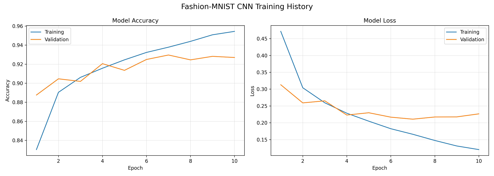
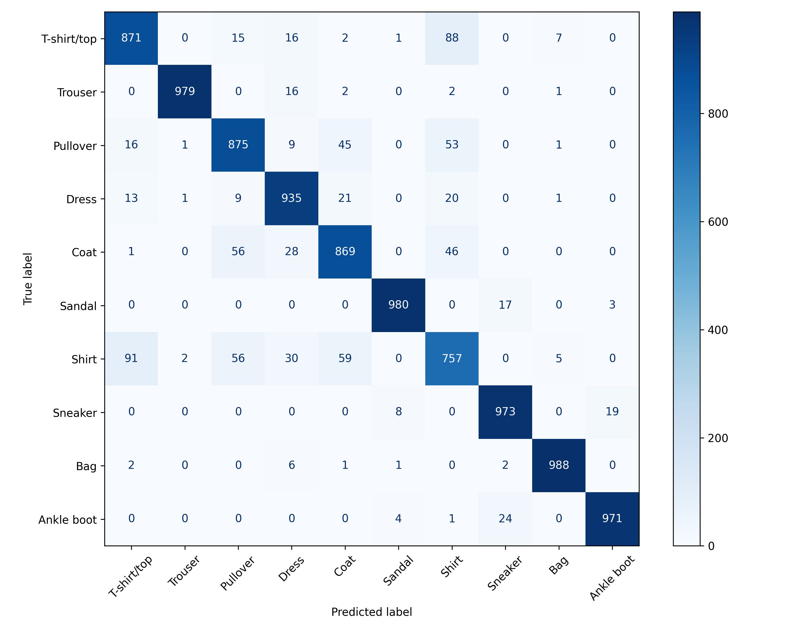
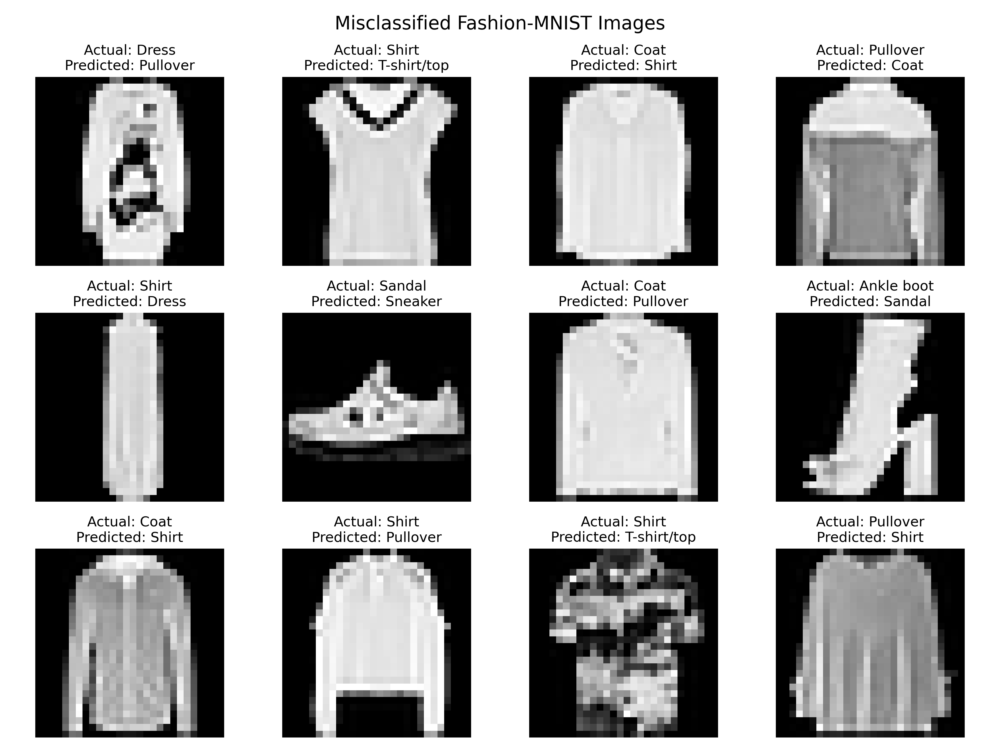

# Fashion-MNIST Image Classification Using a Convolutional Neural Network

**An end-to-end deep learning project for multi-class clothing image classification using TensorFlow/Keras, with reproducible preprocessing, model training, quantitative evaluation, and error analysis.**

**Tech Stack:** Python · TensorFlow/Keras · NumPy · Scikit-learn · Pandas · Matplotlib

---

## 1. Project Overview

This project implements a Convolutional Neural Network (CNN) to classify grayscale clothing images from the Fashion-MNIST dataset into ten categories.

The objective extends beyond achieving high classification accuracy. The project covers the complete supervised machine learning workflow, from dataset preparation and CNN implementation to model evaluation and analysis of classification errors.

The pipeline includes:

- Stratified training-validation splitting.
- Pixel normalization and training-statistics-based standardization.
- CNN-based spatial feature extraction and classification.
- Model training with early stopping and checkpointing.
- Independent evaluation on the official test dataset.
- Per-class precision, recall, and F1-score analysis.
- Confusion matrix visualization and qualitative inspection of misclassified samples.
- Persistent storage of model artifacts and evaluation results.

The final model achieves **91.98% accuracy on 10,000 held-out Fashion-MNIST test images**.

### Key Results

| Metric | Result |
|---|---:|
| Test Accuracy | **91.98%** |
| Test Loss | 0.2326 |
| Correct Predictions | 9,198 / 10,000 |
| Misclassified Images | 802 / 10,000 |
| Best Validation Accuracy | 92.96% |
| Best Validation Loss | 0.2107 |
| Best Checkpoint | Epoch 7 |
| Epochs Executed | 10 |
| Trainable Parameters | 421,642 |

---

## 2. Dataset

The project uses **Fashion-MNIST**, a benchmark dataset containing 70,000 grayscale clothing images distributed across ten categories.

Each image has a resolution of 28 × 28 pixels and is associated with a single integer class label.

### Dataset Distribution

| Partition | Images | Purpose |
|---|---:|---|
| Training | 48,000 | Model parameter optimization |
| Validation | 12,000 | Training monitoring and checkpoint selection |
| Test | 10,000 | Final independent evaluation |
| **Total** | **70,000** | |

The original 60,000-image training partition is divided using an 80:20 stratified split with `random_state=42`.

The official 10,000-image test partition remains separate during model development.

### Classification Categories

| Label | Category |
|---|---|
| 0 | T-shirt/top |
| 1 | Trouser |
| 2 | Pullover |
| 3 | Dress |
| 4 | Coat |
| 5 | Sandal |
| 6 | Shirt |
| 7 | Sneaker |
| 8 | Bag |
| 9 | Ankle boot |

---

## 3. Data Preprocessing

Preprocessing is implemented in `src/preprocessing.py`.

### 3.1 Pixel Normalization

Images are converted to floating-point values and normalized from the original intensity range of 0–255 to 0–1.

The transformation is $X_{norm} = \frac{X}{255}$.

This produces a consistent initial numerical scale for all images.

### 3.2 Statistical Standardization

The mean and variance are computed exclusively from the training subset.

The normalized training, validation, and test images are standardized using the same training-derived statistics.

The transformation is $X_{std} = \frac{X_{norm} - \mu_{train}}{\sqrt{\sigma_{train}^{2} + \epsilon}}$, where $\mu_{train}$ and $\sigma_{train}^{2}$ represent the training-set mean and variance, respectively, and $\epsilon = 10^{-7}$ provides numerical stability.

Computing these statistics only from the training subset avoids introducing validation or test information into the preprocessing parameters.

The resulting statistics are stored in `artifacts/preprocessing.json`.

### 3.3 Image Reshaping

Images are reshaped from `(28, 28)` to `(28, 28, 1)` to satisfy the channel-last input format expected by the convolutional network.

### 3.4 Reproducibility

The dataset split uses stratified sampling and a fixed random seed (`42`) to preserve class proportions and produce deterministic partitions.

---

## 4. CNN Architecture

The network is implemented in `src/model.py` using TensorFlow/Keras.

It consists of two convolutional feature-extraction blocks followed by a fully connected classification head.

### Architecture Summary

| Layer | Configuration | Output Shape |
|---|---|---|
| Input | Grayscale image | 28 × 28 × 1 |
| Conv2D | 32 filters, 3×3, ReLU, same padding | 28 × 28 × 32 |
| MaxPooling2D | 2×2 | 14 × 14 × 32 |
| Conv2D | 64 filters, 3×3, ReLU, same padding | 14 × 14 × 64 |
| MaxPooling2D | 2×2 | 7 × 7 × 64 |
| Flatten | Flatten spatial features | 3,136 |
| Dense | 128 neurons, ReLU | 128 |
| Dropout | Rate = 0.3 | 128 |
| Dense | 10 neurons, Softmax | 10 |

**Total trainable parameters: 421,642**

### Architectural Rationale

**Convolutional layers** extract spatial features from images, beginning with local visual patterns and learning increasingly complex representations.

**Max-pooling layers** reduce the spatial dimensions of feature maps while retaining prominent feature responses.

**ReLU activation** introduces nonlinearity, allowing the network to learn more expressive feature transformations.

**Dropout** provides regularization by randomly disabling a fraction of activations during training.

**Softmax** produces a probability distribution over the ten clothing classes. For class $i$, the output probability is $P(y=i \mid x) = \frac{e^{z_i}}{\sum_{j=1}^{10}e^{z_j}}$, where $z_i$ represents the corresponding output logit.

The predicted class is selected using the maximum output probability.

---

## 5. Training Configuration

Training is implemented in `src/train.py`.

| Hyperparameter | Configuration |
|---|---|
| Optimizer | Adam |
| Learning Rate | 0.001 |
| Loss Function | Sparse Categorical Crossentropy |
| Metric | Accuracy |
| Batch Size | 64 |
| Maximum Epochs | 15 |
| Early Stopping Monitor | Validation Loss |
| Early Stopping Patience | 3 |
| Restore Best Weights | Enabled |
| Model Checkpoint Monitor | Validation Loss |
| Checkpoint Selection | Minimum Validation Loss |

### Loss Function

Sparse categorical crossentropy is used because the targets are integer class labels rather than one-hot encoded vectors.

For a sample with true class $y$, the loss is $L = -\log(P(y \mid x))$.

The optimizer minimizes the average classification loss over the training samples.

### Early Stopping and Model Checkpointing

Two Keras callbacks are used during training:

- `EarlyStopping` monitors validation loss and stops training after three consecutive epochs without improvement, restoring the best weights.
- `ModelCheckpoint` saves the model whenever a lower validation loss is observed.

The best checkpoint occurred at **epoch 7**, with a validation loss of **0.2107**.

Training continued until epoch 10, when early stopping was triggered.

The trained model is saved as `artifacts/fashion_cnn.keras`.

---

## 6. Training Results



The learning curves illustrate how training and validation performance evolved across ten epochs.

### 6.1 Accuracy Analysis

Training accuracy increased from approximately **83.03%** at epoch 1 to **95.44%** at epoch 10.

Validation accuracy improved during the initial training stages and reached its highest recorded value of **92.96%** at epoch 7.

After epoch 7, training accuracy continued increasing, while validation accuracy fluctuated around 92–93%.

This indicates that later improvements on the training set did not consistently translate into improvements on validation data.

### 6.2 Loss Analysis

Training loss decreased steadily from 0.4716 to 0.1203.

Validation loss reached its minimum value of **0.2107 at epoch 7**, before increasing to 0.2265 by epoch 10.

The divergence between training and validation loss provides evidence of **mild overfitting** in the later epochs.

Early stopping and checkpointing helped preserve the model weights associated with the best validation loss.

### Training History

The epoch-level metrics are available in [`reports/training_history.csv`](reports/training_history.csv).

**Note:** The training-history CSV and visualization were reconstructed from rounded metrics recorded in the original training output. They represent the observed training run but do not preserve the original full-precision Keras history values.

---

## 7. Test Set Evaluation

The saved model was evaluated on the official Fashion-MNIST test partition containing 10,000 images.

The test dataset was not used for model training, checkpoint selection, or hyperparameter optimization.

### Evaluation Metrics

| Metric | Value |
|---|---:|
| Test Accuracy | **91.98%** |
| Test Loss | 0.2326 |
| Correct Classifications | 9,198 |
| Incorrect Classifications | 802 |
| Error Rate | 8.02% |

Classification accuracy is calculated as $Accuracy = \frac{N_{correct}}{N_{total}} \times 100$.

The model correctly classified 9,198 of the 10,000 test images.

The difference between the best validation accuracy (92.96%) and test accuracy (91.98%) is approximately **0.98 percentage points**.

This suggests reasonably consistent performance across the validation and test partitions, although performance on Fashion-MNIST does not establish equivalent performance on real-world clothing photographs.

The numerical evaluation results are stored in [`reports/evaluation_metrics.json`](reports/evaluation_metrics.json).

---

## 8. Precision, Recall, and F1-Score

Overall accuracy provides a summary of model performance but does not reveal how classification quality varies between categories.

To examine class-specific performance, precision, recall, and F1-score were calculated using Scikit-learn.

### Metric Definitions

**Precision** measures the proportion of predicted positives that are correct: $Precision = \frac{TP}{TP + FP}$.

**Recall** measures the proportion of actual positives correctly identified: $Recall = \frac{TP}{TP + FN}$.

**F1-score** is the harmonic mean of precision and recall: $F_1 = 2 \times \frac{Precision \times Recall}{Precision + Recall}$.

For multi-class classification, these metrics are calculated separately for each category using a one-versus-rest interpretation.

### Per-Class Results

| Category | Precision | Recall | F1-score | Support |
|---|---:|---:|---:|---:|
| T-shirt/top | 0.88 | 0.87 | 0.87 | 1,000 |
| Trouser | 1.00 | 0.98 | 0.99 | 1,000 |
| Pullover | 0.87 | 0.88 | 0.87 | 1,000 |
| Dress | 0.90 | 0.94 | 0.92 | 1,000 |
| Coat | 0.87 | 0.87 | 0.87 | 1,000 |
| Sandal | 0.99 | 0.98 | 0.98 | 1,000 |
| Shirt | 0.78 | 0.76 | 0.77 | 1,000 |
| Sneaker | 0.96 | 0.97 | 0.97 | 1,000 |
| Bag | 0.99 | 0.99 | 0.99 | 1,000 |
| Ankle boot | 0.98 | 0.97 | 0.97 | 1,000 |

The model achieves particularly strong performance on Trouser, Bag, and Sandal.

However, **Shirt has the lowest F1-score (0.77)**, indicating that it is the most challenging category for the model.

The complete classification report is available in [`reports/classification_report.txt`](reports/classification_report.txt).

---

## 9. Confusion Matrix Analysis



The confusion matrix provides a detailed breakdown of classification outcomes.

Rows represent ground-truth labels, while columns represent model predictions.

Correct predictions appear along the main diagonal. Off-diagonal entries indicate misclassifications.

### Observed Error Patterns

Several prominent errors involve visually similar upper-body clothing categories.

| Actual Class | Predicted Class | Misclassified Samples |
|---|---|---:|
| Shirt | T-shirt/top | 91 |
| T-shirt/top | Shirt | 88 |
| Shirt | Coat | 59 |
| Shirt | Pullover | 56 |
| Coat | Pullover | 56 |
| Pullover | Shirt | 53 |
| Coat | Shirt | 46 |
| Pullover | Coat | 45 |

A total of **179 images were confused between Shirt and T-shirt/top**, considering both prediction directions.

The Shirt category recorded 757 correct predictions out of 1,000 test images, corresponding to 243 classification errors.

These findings suggest that the model has difficulty distinguishing garments with similar shapes, sleeve structures, and silhouettes.

In contrast, categories with more distinctive visual structures, such as Bags and Trousers, exhibit stronger classification performance.

---

## 10. Misclassification Analysis



To complement the quantitative evaluation, twelve misclassified test images were randomly selected and visualized alongside their ground-truth and predicted labels.

A fixed random seed was used to make the example selection reproducible.

### Qualitative Observations

The visualization reveals several types of errors:

- Shirts predicted as T-shirts or other upper-body garments.
- Coats predicted as Shirts or Pullovers.
- Pullovers predicted as Coats.
- Occasional confusion between different footwear categories.

Many of these examples involve clothing items with overlapping visual characteristics.

Because Fashion-MNIST images have a resolution of only 28 × 28 pixels, fine-grained visual details may be difficult to distinguish.

### Interpretation

The errors are not uniformly distributed across the ten categories.

Instead, they are concentrated among particular visually similar classes.

This indicates that the network has learned useful class-discriminative features but retains limitations when distinguishing categories with similar silhouettes.

The randomly selected examples provide qualitative illustrations of failure cases. The confusion matrix provides the quantitative evidence needed to determine how frequently particular errors occur.

---

## 11. Project Structure

```text
fashion-mnist-cnn/
├── artifacts/
│   ├── fashion_cnn.keras
│   └── preprocessing.json
│
├── docs/
│   └── Internship_CNN_Project_Design_Report.pdf
│
├── reports/
│   ├── classification_report.txt
│   ├── confusion_matrix.png
│   ├── evaluation_metrics.json
│   ├── misclassified_examples.png
│   ├── training_curves.png
│   └── training_history.csv
│
├── src/
│   ├── evaluate.py
│   ├── model.py
│   ├── preprocessing.py
│   └── train.py
│
├── .gitignore
└── README.md
```

### Source Files

| File | Responsibility |
|---|---|
| `preprocessing.py` | Dataset loading, splitting, normalization, standardization, and preprocessing-statistics storage |
| `model.py` | CNN architecture definition |
| `train.py` | Model training, validation monitoring, early stopping, and checkpointing |
| `evaluate.py` | Test evaluation, classification metrics, confusion matrix, and misclassification visualization |

### Artifacts and Reports

The `artifacts/` directory stores the trained model and preprocessing statistics.

The `reports/` directory stores numerical evaluation outputs and visualizations.

The `docs/` directory contains the original project design document prepared in LaTeX.

---

## 12. Installation and Usage

### Prerequisites

- Python 3.11
- TensorFlow/Keras
- NumPy
- Scikit-learn
- Pandas
- Matplotlib

GPU acceleration is optional for inference and evaluation.

The original model was trained using TensorFlow with GPU acceleration under WSL2. Evaluation was subsequently executed successfully using CPU-based TensorFlow on Windows.

### Clone the Repository

```bash
git clone https://github.com/Abishe77/fashion-mnist-cnn.git
cd fashion-mnist-cnn
```

### Create a Virtual Environment

```bash
python -m venv .venv
```

Activate it on Windows:

```powershell
.venv\Scripts\Activate.ps1
```

Or on Linux/WSL:

```bash
source .venv/bin/activate
```

### Install Dependencies

```bash
python -m pip install tensorflow numpy scikit-learn pandas matplotlib
```

### Train the CNN

From the repository root:

```bash
python src/train.py
```

The training pipeline performs preprocessing, builds the CNN, trains the model, and saves the best checkpoint to `artifacts/fashion_cnn.keras`.

### Evaluate the Saved Model

```bash
python src/evaluate.py
```

The evaluation script loads the saved model and produces:

- Test accuracy and loss.
- Per-class classification metrics.
- Confusion matrix visualization.
- Misclassified image examples.

Evaluation outputs are stored in `reports/`.

**Reproducibility note:** The repository includes the trained model and preprocessing statistics. Training outcomes may vary across environments due to random initialization, hardware, numerical implementations, and other sources of nondeterminism.

---

## 13. Limitations

Despite achieving strong test accuracy, the model has several limitations.

### 13.1 Low Image Resolution

Fashion-MNIST images contain only 784 grayscale pixels.

Fine-grained details such as garment textures, collars, and sleeve structures may not be clearly represented.

### 13.2 Similarity Between Classes

Upper-body clothing categories share substantial visual characteristics.

This contributes to confusion between Shirts, T-shirts, Pullovers, and Coats.

### 13.3 Dataset-Specific Evaluation

The model was evaluated on the Fashion-MNIST benchmark.

Its performance on real-world clothing photographs, different image resolutions, backgrounds, lighting conditions, or image distributions has not been established.

### 13.4 Limited Architectural Exploration

The project evaluates one CNN architecture rather than performing a systematic comparison of multiple architectures and hyperparameter configurations.

### 13.5 Reconstructed Training History

The training curves were reconstructed from rounded training logs rather than exported automatically during the original training run.

Future experiments should persist the complete training history directly during model fitting.

---

## 14. Potential Improvements

Future extensions could investigate:

- **Data augmentation:** Introduce controlled transformations to improve robustness.
- **Architecture comparisons:** Compare the current CNN against deeper or residual architectures.
- **Hyperparameter optimization:** Evaluate learning rates, batch sizes, dropout rates, and filter configurations.
- **Class-specific error analysis:** Investigate systematic confusion between upper-body clothing categories.
- **Calibration analysis:** Examine whether predicted class probabilities accurately reflect empirical correctness.
- **Out-of-distribution evaluation:** Test robustness on images outside the original Fashion-MNIST distribution.
- **Automated experiment tracking:** Persist complete training histories, configurations, and evaluation artifacts for future runs.

These are proposed extensions and are not part of the current experimental results.

---

## 15. Project Documentation

The original project design report is available here:

[**Internship CNN Project — LaTeX Design Report (PDF)**](docs/Internship_CNN_Project_Design_Report.pdf)

This document is retained as part of the project's design documentation.

The README provides the implementation overview, experimental results, and final evaluation analysis.

---

## 16. Conclusion

This project demonstrates the development and evaluation of a Convolutional Neural Network for multi-class image classification using Fashion-MNIST.

The implemented CNN achieves **91.98% test accuracy** across 10,000 previously unseen benchmark images.

The experiment demonstrates the effectiveness of convolutional feature extraction for small grayscale image classification while highlighting the importance of validation monitoring, checkpointing, and detailed model evaluation.

The confusion matrix and misclassification analysis show that the model's errors are concentrated primarily among visually similar clothing categories, particularly Shirts, T-shirts, Pullovers, and Coats.

Beyond the final accuracy, the project emphasizes a complete and documented machine learning workflow, including preprocessing, architecture implementation, training, model persistence, quantitative evaluation, and error analysis.

---

## References

1. Xiao, H., Rasul, K., & Vollgraf, R. (2017). *Fashion-MNIST: A Novel Image Dataset for Benchmarking Machine Learning Algorithms.* [arXiv:1708.07747](https://arxiv.org/abs/1708.07747)
2. [TensorFlow / Keras Documentation](https://www.tensorflow.org/guide/keras)
3. [Scikit-learn Classification Metrics](https://scikit-learn.org/stable/modules/model_evaluation.html)

---

**Repository:** [github.com/Abishe77/fashion-mnist-cnn](https://github.com/Abishe77/fashion-mnist-cnn)
